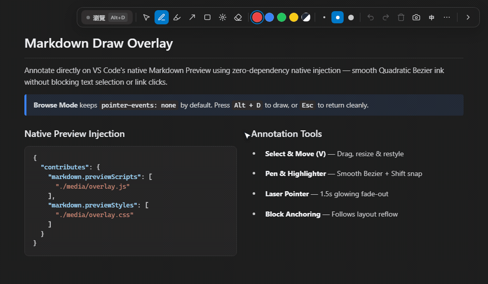
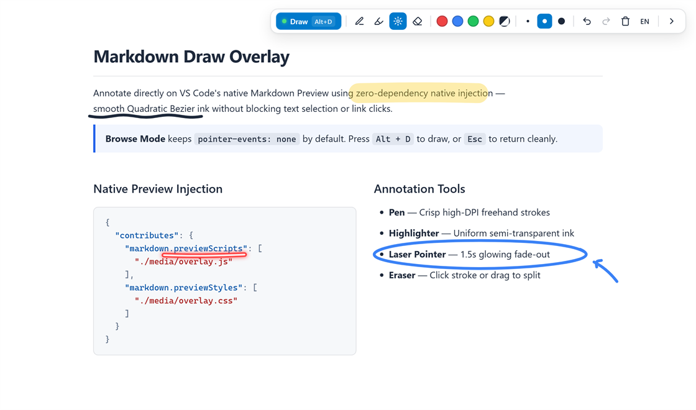

# Markdown Draw Overlay

[](https://marketplace.visualstudio.com/items?itemName=serge45-md-draw.markdown-draw-overlay)
[](https://marketplace.visualstudio.com/items?itemName=serge45-md-draw.markdown-draw-overlay)
[](https://open-vsx.org/extension/serge45-md-draw/markdown-draw-overlay)
[](https://open-vsx.org/extension/serge45-md-draw/markdown-draw-overlay)

**Language:** English | [繁體中文](README.zh-TW.md)

Draw, highlight, and present with an auto-fading laser pointer directly on VS Code's native **Markdown Preview** (with optional **Markdown Preview Enhanced** integration) — without blocking text selection, link clicking, or scrolling.



### Theme Adaptation (Light Mode)

Automatically adapts toolbar styling and adaptive ink contrast between Dark Mode and Light Mode (including light paper themes in Markdown Preview Enhanced):



## Key Features

- **Zero-Dependency Native Preview Injection**: Uses VS Code's official `contributes.markdown.previewScripts` and `contributes.markdown.previewStyles` instead of a custom Webview, and adds an editor title bar button on `.md` files to open the native preview in one click.
- **Coexists with Markdown Preview Enhanced (MPE)**:
  - Open the native preview side-by-side anytime via the editor title bar icon without interfering with MPE.
  - Or run the built-in command to inject the overlay into MPE's global `head.html`, complete with actual preview surface brightness detection, automatic MPE Sidebar TOC avoidance, and print/HTML export guards.
- **Scroll-Synced, Block-Anchored & High-DPI Sharp**: Automatically anchors annotations to underlying Markdown blocks (`h1`–`h6`, `p`, `pre`, `table`, `blockquote`, `li`, `img`, etc.) so strokes follow layout reflow, zoom, and preview resize, while scaling buffers with `window.devicePixelRatio`.
- **Smooth Quadratic Bezier Strokes**: Combines Pointer Coalesced Events with EMA filtering and Quadratic Bezier interpolation so fast strokes stay fluid.
- **Anti-Accidental-Touch Dual Mode**:
  - **Browse Mode (Default)**: `pointer-events: none` — select text, copy, scroll, and click links normally.
  - **Draw Mode**: Press `Alt + D` or click the toolbar toggle to start annotating; press `Esc` to return to Browse Mode while keeping strokes visible.
- **Annotation Tools & Unified Cursors**:
  1. **Select, Move, Resize & Restyle (`V`)**: Click or drag a marquee box to select single or multiple annotations (`Shift` to toggle/add, `Ctrl/Cmd + A` to select all), drag to move, drag the 4 corner handles to resize (`Shift` for proportional scaling), click palette colors or `S / M / L` sizes to restyle in-place, nudge with arrow keys (`Shift` for 10px), or press `Delete`/`Backspace` to remove.
  2. **Pen**: Crisp solid freehand strokes (hold `Shift` for straight lines with magnetic horizontal/vertical snap).
  3. **Highlighter**: Semi-transparent wide marker (yellow by default) with uniform opacity (hold `Shift` for straight highlights).
  4. **Arrow**: Directional callout arrow (hold `Shift` to snap to 15° angles).
  5. **Rectangle**: Rounded outline box to frame code blocks or sections (hold `Shift` for squares).
  6. **Laser Pointer**: Glowing beam (with selectable colors) that smoothly fades out over **1.5 seconds** after release (excluded from Undo/Redo history).
  7. **Eraser**: Click to delete an entire stroke or shape, or drag to erase segments cleanly.
  - All drawing tools display a live color- and size-matched canvas cursor (dot, translucent ring, crosshair + center dot, or glowing laser spot).
- **Per-Document Persistence & Portable `.mdo.json`**: Automatically saves strokes per document across edits/reloads (toggleable in `⋯`), plus one-click `.mdo.json` export & import without touching your `.md` source.
- **One-Click Annotated PNG Export**: Click the camera button to download a timestamped PNG of the current viewport with your annotations (and copy to clipboard where supported, with automatic fallback under strict CSP).
- **VS Code Theme-Adaptive & Bilingual UI**: Frosted-glass floating toolbar (`backdrop-filter: blur`) built on VS Code CSS variables, adaptive black/white ink based on actual preview surface luminance, and auto-detected **English / 繁體中文** UI with a 1-click `EN` / `中` toolbar toggle.

---

## Keyboard Shortcuts

| Shortcut | Action |
| --- | --- |
| `Alt + D` | Toggle **Browse Mode** / **Draw Mode** |
| `V` | Switch to **Select, Move & Resize** tool (in Draw Mode) |
| `Esc` | Close menu, clear active selection, or return to **Browse Mode** |
| `Shift + Drag` | Straight line (`Pen` / `Highlighter`), 15° snap (`Arrow`), Square (`Rectangle`), or Proportional Resize (`Select`) |
| `Arrow Keys` / `Shift + Arrows` | Nudge selected annotations by `1px` / `10px` |
| `Delete` / `Backspace` | Delete selected annotations |
| `Ctrl + A` / `Cmd + A` | Select all annotations (in `Select` tool) |
| `Ctrl + Z` / `Cmd + Z` | Undo |
| `Ctrl + Y` / `Ctrl + Shift + Z` / `Cmd + Shift + Z` | Redo |

---

## Coexistence with Markdown Preview Enhanced (MPE)

### Option 1: Side-by-Side Native Preview (Zero Setup)
When editing any `.md` file, click the **pen icon button** (`Markdown Draw Overlay: Open Markdown Preview`) in the editor title bar to open VS Code's native Markdown Preview with `md-draw` enabled alongside MPE.

### Option 2: Draw Directly Inside MPE Preview (One-Click `head.html` Sync)
1. Open the Command Palette (`Ctrl + Shift + P` / `Cmd + Shift + P`) and run:
   **`Markdown Draw Overlay: Enable MPE Preview Integration (head.html)`**
2. The extension writes `markdown-draw-overlay.js` and a managed style/script block into MPE's global config directory (`%USERPROFILE%\.crossnote\` on Windows, or `markdown-preview-enhanced.configPath`).
3. Ensure both MPE security requirements are satisfied (the command also prompts to enable the setting for you):
   - User setting `"markdown-preview-enhanced.enablePreviewScripts": true`
   - The current folder is a **Trusted Workspace**
4. Reopen or refresh the MPE preview tab to see the floating toolbar.
5. To uninstall MPE integration cleanly at any time, run **`Markdown Draw Overlay: Remove MPE Preview Integration`**.

---

## Development, Build & Testing (`F5`)

### 1. Install Dependencies & Compile
```bash
npm install
npm run compile
```

### 2. Launch Extension Development Host (`F5`)
1. Open this repository in VS Code.
2. Open the Run and Debug view and press **`F5`**:
   - **`Run Markdown Draw Overlay`**: Launches with your installed extensions (ideal for testing both Native Preview and MPE coexistence).
   - **`Run Markdown Draw Overlay (Isolated / No Other Extensions)`**: Launches with `--disable-extensions` for clean native-only testing.
3. Open any `.md` file (such as `README.md`) in the Extension Development Host window.
4. Click the pen icon in the editor title bar (or press `Ctrl+Shift+V` / `Ctrl+K V`) to open Markdown Preview:
   - Verify **Browse Mode** allows selecting text and clicking links normally.
   - Press **`Alt + D`** to enter **Draw Mode** and test Pen, Highlighter, 1.5s Laser Pointer, Eraser (click & drag), Colors, 3 Sizes, Undo/Redo, Clear All, `EN` / `中` language toggle, and Toolbar collapse/expand.
   - Press **`Esc`** to exit back to Browse Mode.

---

## Project Structure

```text
md-draw/
├── .vscode/
│   ├── launch.json             # F5 Extension Development Host configs (standard & isolated)
│   └── tasks.json              # Default npm compile build task
├── l10n/
│   ├── bundle.l10n.json        # Extension host English localization bundle
│   └── bundle.l10n.zh-tw.json  # Extension host Traditional Chinese localization bundle
├── media/
│   ├── overlay.css             # Canvas layer & frosted-glass floating toolbar styles
│   └── overlay.js              # Preview overlay engine, smooth ink, laser, eraser & i18n
├── src/
│   └── extension.ts            # Extension entry point, preview command & MPE head.html manager
├── package.json                # Extension manifest, editor/title menu & previewScripts/Styles
├── package.nls.json            # Manifest localization (English)
├── package.nls.zh-tw.json      # Manifest localization (Traditional Chinese)
├── tsconfig.json               # TypeScript configuration
├── README.md                   # English documentation
└── README.zh-TW.md             # Traditional Chinese documentation
```

## Quick Customization Pointers

- **Laser Fade Duration**: Adjust `LASER_FADE_MS` (default `1500` ms) in [media/overlay.js](media/overlay.js).
- **Palette & Brush Widths**: Adjust `PALETTE` and `SIZE_MAP` in [media/overlay.js](media/overlay.js).
- **Toolbar Position & Blur**: Adjust `#mdo-toolbar` styles in [media/overlay.css](media/overlay.css).
